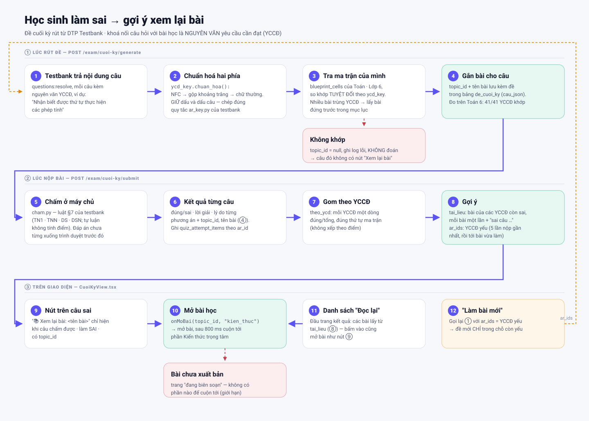
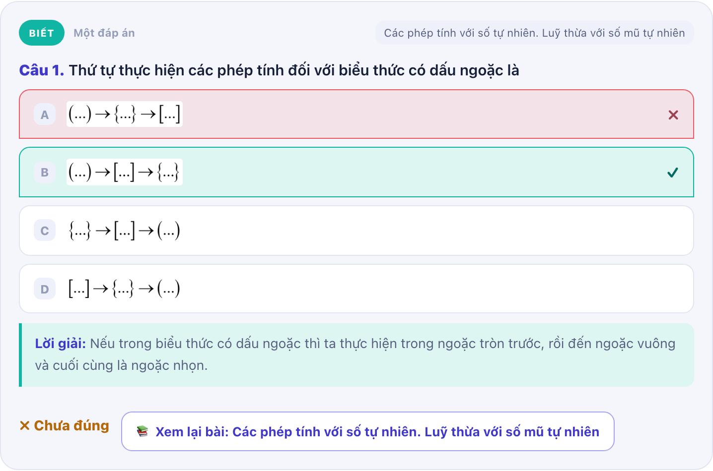
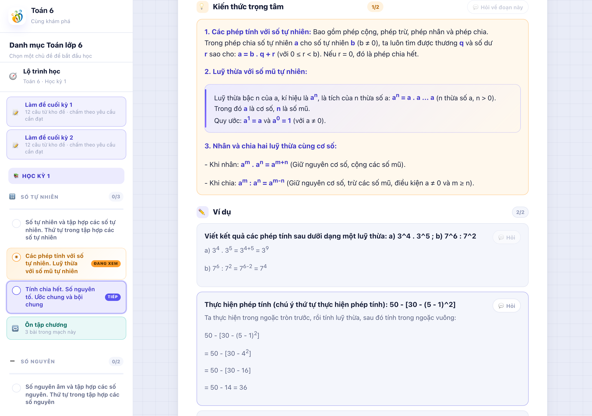
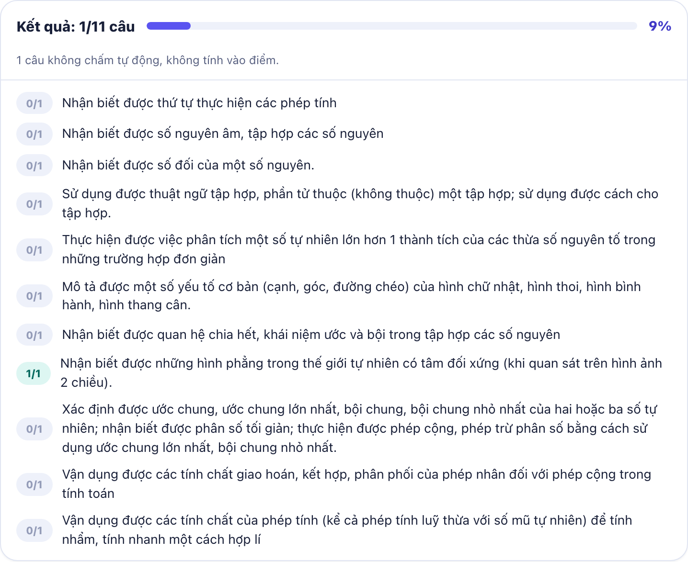
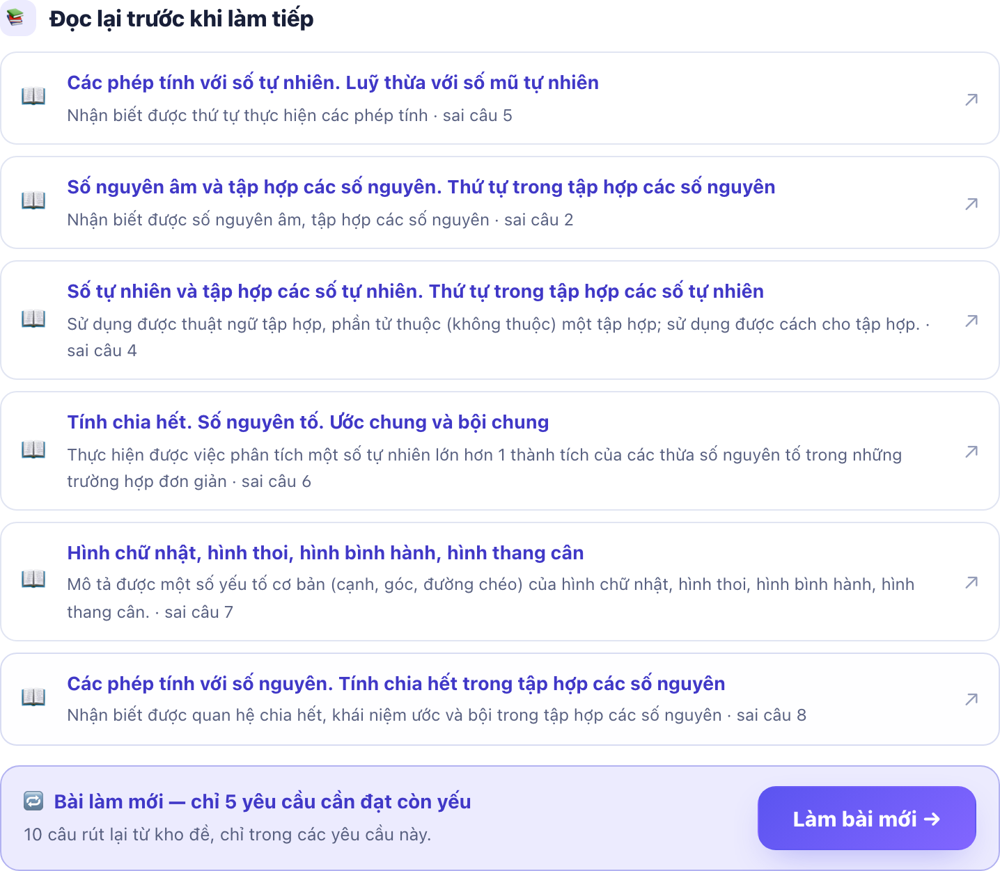

# Làm sai đề cuối kỳ → gợi ý xem lại bài

> **Cập nhật US-27:** các khối "Đọc lại trước khi làm tiếp" và "Làm bài mới" mô tả dưới đây đã được thay bằng khối "Đề xuất" chung (xem `DE-XUAT-KHO-HOC-LIEU.md`). Trường `goi_y` vẫn còn trong API nhưng giao diện không dùng nữa.

Tài liệu giải thích: khi học sinh làm sai một câu trong **đề cuối kỳ** (rút từ DTP
Testbank), hệ thống dựa vào đâu để chỉ em quay về **đúng bài học**, và những gợi ý
nào hiện ra sau khi nộp.

Liên quan: [STEPS-demo-4-buoc.md](STEPS-demo-4-buoc.md) (kế hoạch demo 4 bước),
tài liệu API của testbank `dtp-testbank/docs/24-HUONG-DAN-API-CHO-LEARNING.md`.

---

## Tóm tắt một câu

Câu hỏi của testbank và bài học của mình **gặp nhau ở nguyên văn yêu cầu cần đạt
(YCCĐ)**: câu nào mang YCCĐ trùng khớp với một ô trong ma trận đặc tả của mình thì
thuộc về bài học chứa ô đó. Không khớp thì không gắn — **không đoán**.

---

## ① Lúc rút đề — tìm bài học cho từng câu

`POST /exam/cuoi-ky/generate` · [app/api/cuoi_ky.py](../app/api/cuoi_ky.py), hàm `_ban_do_yccd`

1. Testbank trả nội dung câu (`questions:resolve`). Mỗi câu kèm **nguyên văn YCCĐ**
   (`yccd_text`), ví dụ *"Nhận biết được thứ tự thực hiện các phép tính"*.
2. Chuẩn hoá nguyên văn ở **cả hai phía** bằng
   [`ycd_key.chuan_hoa`](../app/lessons/ycd_key.py): NFC → gộp khoảng trắng → bỏ
   khoảng trắng hai đầu → chữ thường. **Giữ nguyên dấu và dấu câu.** Quy tắc này
   chép đúng `content_service/ar_key.py` của testbank — hai bên phải ra cùng một
   chuỗi.
3. Tra mọi ô ma trận (`blueprint_cells`) của **Toán · Lớp 6**. Chuỗi chuẩn hoá trùng
   nhau → câu thuộc bài (`curriculum_topics`) của ô đó.
4. `topic_id` + tên bài được lưu cùng đề trong bảng `de_cuoi_ky` (cột `cau_json`),
   để lúc nộp không phải tra lại.

| Trường hợp | Xử lý |
|---|---|
| Khớp đúng một bài | Gắn bài đó |
| Một YCCĐ nằm ở nhiều bài (mục lục có bài trùng) | Lấy bài **đứng trước** trong mục lục — cố định giữa các lần gọi |
| Không khớp (lệch dù một dấu phẩy) | `topic_id = null`, ghi **log lỗi**, câu đó **không có** nút "Xem lại bài" |

> Vì sao không khớp "gần đúng"? Gắn câu vào **sai bài** mà không ai biết còn tệ hơn
> không gắn: học sinh bị đưa đi đọc một bài chẳng liên quan tới chỗ mình sai.
> Đo trên Toán 6 (18/10/2026): **41/41 YCCĐ** của testbank khớp ma trận của mình.

---

## ② Lúc nộp bài — chấm và gom gợi ý

`POST /exam/cuoi-ky/submit` · [app/api/cuoi_ky.py](../app/api/cuoi_ky.py), hàm `submit`

- **Chấm ở máy chủ** ([cham.py](../app/integrations/testbank/cham.py)) theo luật §7
  của testbank. Đáp án (`answer_key`) không xuống trình duyệt trước khi nộp. Câu tự
  luận không chấm tự động, không tính điểm.
- Mỗi câu trả về: đúng/sai, đáp án, lời giải, lý do từng phương án, **`topic_id` +
  tên bài** (từ bước ①).
- Ghi lịch sử từng câu vào `quiz_attempt_items` theo `ar_id` (mã YCCĐ bên testbank)
  — nền cho thống kê "YCCĐ nào còn yếu".
- Gom thành ba thứ:

| Trường trả về | Là gì |
|---|---|
| `theo_ycd` | Kết quả theo **từng YCCĐ** (đúng/tổng), đúng thứ tự ma trận — không xếp theo điểm |
| `goi_y.tai_lieu` | Các **bài học** của những YCCĐ còn sai, mỗi bài **một lần** dù sai nhiều câu, kèm "sai câu 3, 8" |
| `goi_y.ar_ids` | YCCĐ còn yếu cho "Làm bài mới": ưu tiên YCCĐ yếu theo lịch sử **5 lần nộp gần nhất** (đủ ≥ 2 câu mới kết luận), sau đó tới YCCĐ vừa sai trong bài này — tối đa 5 |

Cách chọn `ar_ids`: [`ycd_thong_ke.chon_ar_on_lai`](../app/lessons/ycd_thong_ke.py).

---

## ③ Trên giao diện

[web/src/learn/CuoiKyView.tsx](../web/src/learn/CuoiKyView.tsx)

### Nút "Xem lại bài" trên từng câu sai

Nút chỉ hiện khi **đủ cả ba**: câu chấm tự động được · học sinh làm **sai** · câu có
`topic_id` (đã khớp bài ở bước ①).

Bấm nút → `onMoBai(topic_id, "kien_thuc")` → mở bài đó rồi, sau 800 ms chờ bài hiện
ra, cuộn tới phần **Kiến thức trọng tâm** (`#phan-kien_thuc`) —
[LearnApp.tsx](../web/src/learn/LearnApp.tsx), hàm `moBaiTuHoSo`.

### Đầu trang kết quả: chấm theo YCCĐ

### "Đọc lại trước khi làm tiếp" + "Làm bài mới"

Danh sách bài từ `goi_y.tai_lieu` (bấm vào cũng mở bài như nút trên câu), và nút
**Làm bài mới** gọi lại bước ① với `ar_ids` — đề mới chỉ rút trong các YCCĐ còn yếu
(2 câu mỗi YCCĐ, trong khoảng 4–12 câu).

> Ảnh 2–3 chụp ở một lần làm bài khác với ảnh 1, nên số câu trong ảnh không khớp
> nhau. Tất cả chụp trên máy dev với testbank local.

---

## Giới hạn hiện tại

| # | Giới hạn | Hệ quả | Hướng sửa |
|---|---|---|---|
| 1 | Luôn mở phần **Kiến thức trọng tâm** | Không trỏ tới đúng ví dụ / đoạn liên quan tới câu sai | Chọn đoạn bài có nội dung gần câu sai nhất |
| 2 | Gợi ý theo **câu**, chưa theo **phương án đã chọn** | Chọn sai A hay sai C đều về cùng một bài | Testbank đã có `question_resource.option_key` (loại Ôn lại / Củng cố) — chờ mở cho đối tác |
| 3 | Bài **chưa xuất bản** vẫn có nút | Bấm vào chỉ thấy "đang được biên soạn", không có phần để cuộn tới | Ẩn nút / bỏ khỏi `tai_lieu` khi bài chưa có nội dung đã xuất bản |
| 4 | Phụ thuộc **câu chữ** ma trận | Nạp lại ma trận mà sửa nguyên văn YCCĐ là mất khớp (log báo lỗi) | Giữ nguyên văn YCCĐ đồng bộ với testbank |
| 5 | Cuộn sau **800 ms** đặt cứng | Máy chậm, bài chưa kịp hiện thì không cuộn tới | Cuộn khi bài render xong thay vì hẹn giờ |

---

## Kiểm tra nhanh

- Test: `tests/api/test_cuoi_ky.py` (`test_khop_yccd_ve_dung_bai_hoc`: khớp bỏ qua hoa
  thường/khoảng trắng nhưng **không** bỏ qua dấu câu),
  `tests/lessons/test_chon_ar_on_lai.py`.
- Log khi không khớp: tìm `YCCĐ testbank không khớp ma trận` trong log API.
